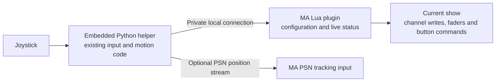

# Direct show output from an MA plugin

Investigation: 2026-10-20, grandMA3 onPC 2.5 on macOS. This is a research
recommendation for the requested finished plugin, not an implemented output mode.
The operator's successful OSC movement test remains recorded in
[ACCEPTANCE.md](../../docs/ACCEPTANCE.md).

## Answer

**Yes: Lua running in an MA plugin can operate its current show directly.**
The external Python helper still needs a way to pass its results to Lua, but
that connection can be private and automatic. It does not require an OSC row,
destination IP, port or prefix in the operator's normal setup.

MA's documented [`Cmd()` API](https://help.malighting.com/grandMA3/2.2/HTML/lua_objectfree_cmd.html)
executes console commands and returns command feedback. The matching document
ships with the installed 2.5 release as
`shared/language/HTML/lua_objectfree_cmd.html`. Therefore the exact command
string used by the successful OSC test can instead be executed inside Lua.
That removes the OSC transport, but its `ClearSelection; MArker ...` commands
would still change the operator's selection.

There is also a stronger candidate for movement: **address the MArker's
programmer channels directly with `SetProgPhaser()`**. This avoids expressing
each position update as selection commands. MA's release notes acknowledge
this API, and its installed 2.5 system tests demonstrate its inputs and check
the resulting programmer values. This is evidence for a feasible direct
adapter. The operator subsequently confirmed native MArker movement through
the finite probe in onPC 2.5.1.0; its report also preserved the unrelated
selection/grid and encoder context. The operator also observed direct
brightness reaching 100% from 0%; this exposed a premature readback assertion
in the probe. Its timing fix is covered offline and awaits a combined-output
retest; see the [acceptance record](../../docs/ACCEPTANCE.md).

A finite importable probe is now prepared:
[Stage 3: direct output inside MA](DIRECT_TEST.md). It isolates the native
channel API without needing a Python helper or network transport at runtime.

## Evidence and its limits

The installed sources below are under
`/Users/huang/MALightingTechnology/gma3_2.5.0/shared/`.
They were read, not executed: MA's system tests prepare and modify their test
show and must not be run against the operator's working show.

| Finding | Primary evidence | What remains to check |
| --- | --- | --- |
| A plugin can execute commands internally. | `language/HTML/lua_objectfree_cmd.html`; `resource/lib_plugins/systemtests/db/system_test_api_tests.lua` also checks `Cmd()` feedback. | Equivalent movement through Lua rather than the already verified OSC receiver. |
| Programmer channels can be written by UI channel index, with step values expressed as percentages. | `resource/lib_plugins/systemtests/db/system_test_api_tests.lua`, first test: `SetProgPhaser(index, {..., [1]={absolute=10}, ...})`, followed by `GetProgPhaser()` assertions. [MA's 2.2 release notes](https://help.malighting.com/grandMA3/2.5/HTML/key_rn_v2_2.html) also describe this API. | Single-step XYZ output, replacement versus merging of existing phaser/preset/relative data, side effects and sustained update rate. The API test initializes a selected dimmer; it does not prove starting with an unselected MArker. |
| A fixture's attribute channel can be resolved without issuing a selection command. | `resource/lib_plugins/systemtests/help/system_test_helping_functions_db.lua`, `GetUIChannelByAttrForFixture()`: `ObjectList(...)`, `.SubfixtureIndex`, `GetAttributeIndex()` and `GetUIChannelIndex()`. | MArker CID resolution in the current show, missing/duplicate targets, and invalidation after patch/show changes. Do not use the adjacent `GetChannelIdxForFixtures()` helper: it changes the selection. |
| Brightness and zoom/iris need no OSC receiver. | MA's documented [`SetFader()`](https://help.malighting.com/grandMA3/2.5/HTML/lua_object_setfader.html) supports Master and Temp. `resource/lib_plugins/systemtests/db/system_test_fader_temp.lua` uses a sequence's Temp fader and checks output. | Correct executor-to-object resolution and the configured Master/Temp behavior. Keep the existing executor mapping unless explicitly migrated. |
| MA knows the MArker's Movement Space. | `resource/lib_plugins/systemtests/db/system_test_xyz_MArker.lua` sets `MovementSpace`, space bounds and XYZ attributes. | Reading and resolving that reference reliably. Automatic detection could remove duplicated percent-conversion bounds; retain an explicit fallback until verified. |

The installed API test's use of an indexed channel is more precise evidence
than the earlier statement that there was no Lua route worth investigating.
It does **not** establish an API that bypasses the programmer entirely.

## Why Python remains useful

The prior imported diagnostic established that this MA runtime can launch the
embedded Python helper, while native dynamic-library loading was disabled.
No generic joystick/HID Lua API was found. Reuse `joystick.py` for native HID
and SDL input rather than replacing working device support.

Reuse `followspot_core.py` for settings validation, calibrated proportional
motion, dead zones, bounds, figure-eight tests, button edges and PSN streaming.
The existing `Controller` emits OSC-shaped addresses and command strings;
introduce a small output adapter/event interface rather than duplicate the
motion logic or parse command strings back into coordinates.

The proposed local path is:

The working diagnostic's atomic files and owned heartbeat offer an initial
local connection with no user-configured port. Its latency and filesystem
activity need measurement for continuous use. Position can use the latest
sample; button press/release commands need acknowledged ordering so polling
cannot lose an edge. Python cannot call MA's Lua APIs directly from its
separate process.

## Direct output and PSN serve different purposes

Direct programmer output would remove external protocol setup for normal
local operation. It still uses the user's programmer. MA documents its
[Blind, Program Time, Preview and playback-priority behavior](https://help.malighting.com/grandMA3/2.5/HTML/operate_programmer.html).
Selection preservation alone does not isolate followspot values from Clear,
Store, timing or other programming. Those interactions must be tested and
made clear in the Live view; the plugin should not silently change the
operator's global programming modes.

PSN feeds MA's separate tracking-input path, with tracker-to-MArker mapping and
merge priority. See [MA's PSN documentation](https://help.malighting.com/grandMA3/2.5/HTML/remote_inputs_psn.html).
Keep it as an optional position mode for that behavior. Brightness, zoom/iris
and button commands can still be applied internally by Lua in PSN mode, so
**choosing PSN need not also require OSC setup**.

PSN still needs its interface, tracker mapping and merge configuration. Use
same-Mac defaults and inspect existing configuration where supported; do not
silently overwrite unrelated In & Out settings. The existing Stop/hold versus
Release behavior must carry over, including the observed return to origin
when streaming ends; see [PSN.md](../../docs/PSN.md).

## Recommendation for the finished plugin

Use one importable XML containing the Lua UI and embedded Python sources.
Aim for direct show output as the normal mode, with PSN as an optional position
mode. Keep OSC for the standalone app and the existing diagnostic; it need not
be part of the plugin's normal local configuration.

The MA configuration pages should expose the operator's decisions: joystick
selection/calibration and learning, MArker or pan/tilt target, speed and limits,
brightness/zoom executors, buttons, and test/diagnostic status. Show PSN fields
only when PSN is selected. Keep machine-specific input/Python preferences
separate from show target mappings. Persistence and native UI layout still
need a concrete implementation design; the research does not establish them.

The finite onPC test established direct MArker motion with unrelated selection
and encoder context preserved. The operator subsequently confirmed combined
0% → 100% Master brightness and XYZ startup, including empty selection. The
full implementation is described in [the plugin guide](../../docs/PLUGIN.md).
Remaining checks include Temp behavior, existing phaser/relative programmer
data, Blind/timing/priority behavior and early `Off Plugin` cleanup. Offline
mocks cannot establish these results; see [the acceptance record](../../docs/ACCEPTANCE.md).
